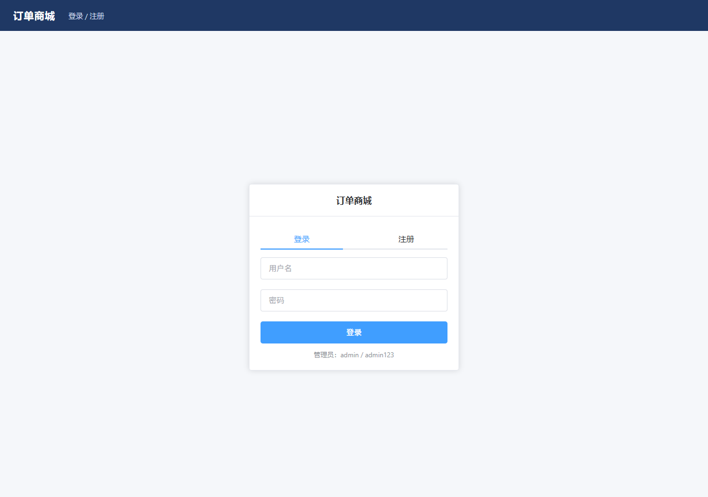
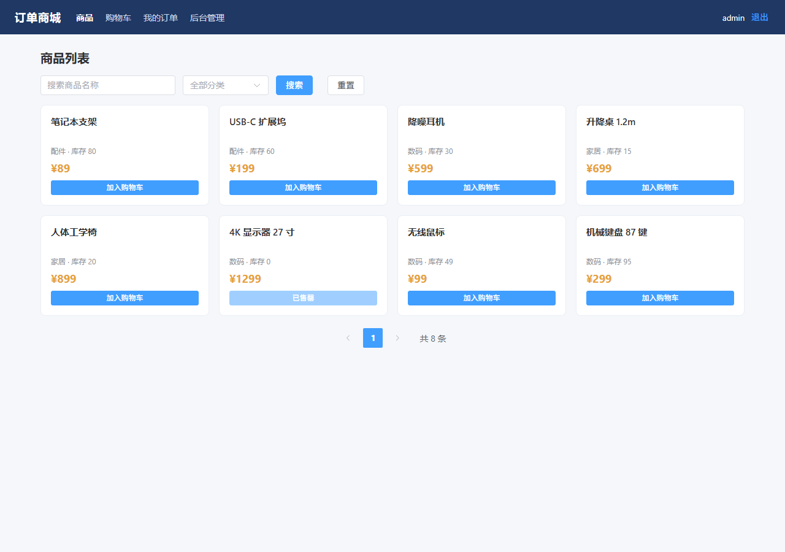
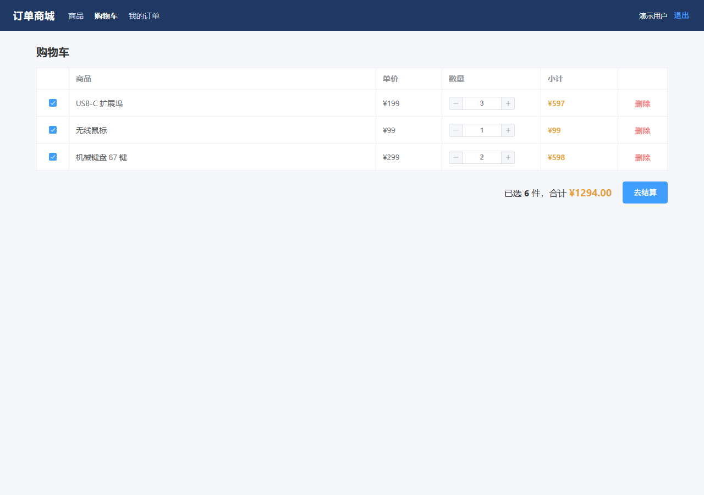
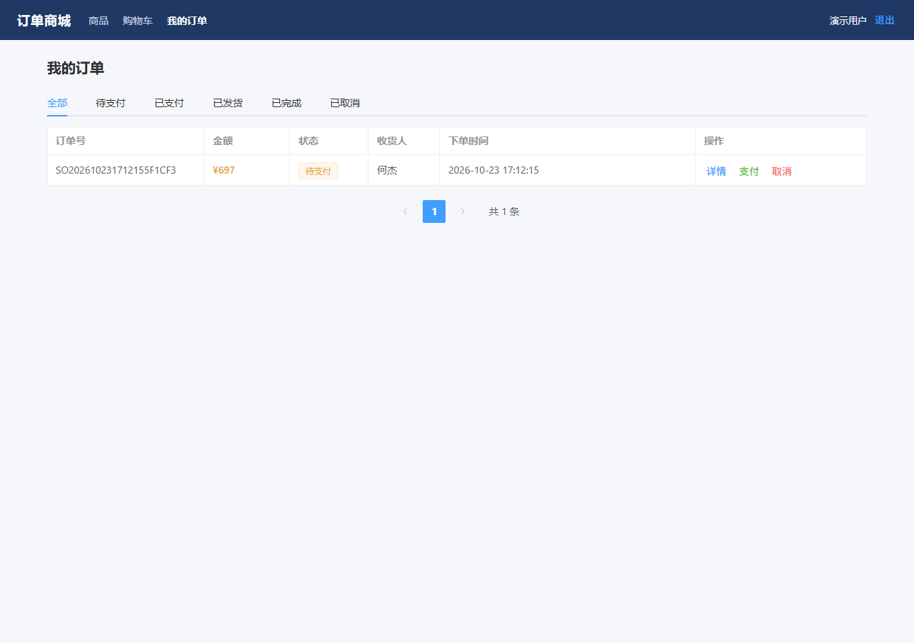
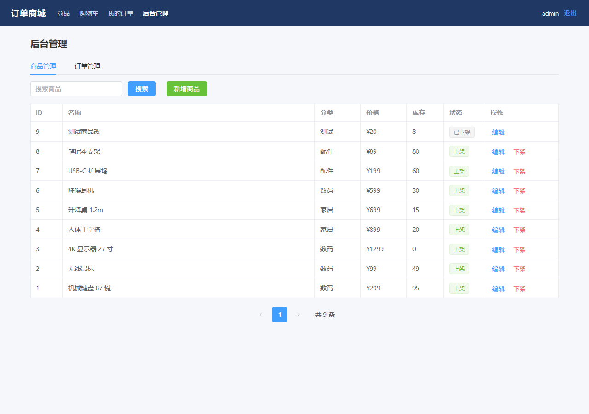

# order-mall · 订单商城

Spring Boot + MySQL + Vue 3 的全栈订单系统，用于 Java 后端求职作品展示。

> 状态：全部完成（M1–M8）。后端 24 个接口、前端 5 个页面、接口文档、压测报告、部署说明齐备。

## 技术栈

后端：Spring Boot 3.2.5 · JDK 17 · Spring JDBC（JdbcTemplate）· MySQL 8 · Maven
前端：Vue 3 · Vite · Element Plus · Axios · Vue Router

## 页面预览

| 登录 | 商品列表 |
|---|---|
|  |  |

| 购物车 | 我的订单 |
|---|---|
|  |  |

| 后台管理 |
|---|
|  |

## 目录结构

```
order-mall/
├── backend/                    Spring Boot 后端
│   ├── pom.xml
│   └── src/main/
│       ├── java/com/example/mall/
│       │   ├── common/      ApiResponse / BizException / GlobalExceptionHandler / PageResult / PasswordUtil / PaySignUtil
│       │   ├── config/      AuthInterceptor / WebConfig / DataInitializer
│       │   ├── controller/  Auth / Product / AdminProduct / Cart / Order / AdminOrder / Pay / Health
│       │   ├── service/     UserService / TokenService / ProductService / CartService / OrderService
│       │   ├── dao/         UserDao / ProductDao / CartDao / OrderDao
│       │   ├── model/       User / Product / CartItem / Order / OrderItem
│       │   └── dto/         请求与展示对象
│       └── resources/       application.yml / schema.sql
├── frontend/                   Vue 3 前端
│   ├── vite.config.js          /api 代理到 18091
│   └── src/
│       ├── api/                request.js（拦截器）/ index.js（接口封装）
│       ├── router/             路由与登录/角色守卫
│       ├── views/              Login / Products / Cart / Orders / Admin
│       └── styles/main.css
└── docs/screenshots/
```

## 启动

### 1. 后端

```powershell
cd B:\dshWork\02-测试项目\order-mall\backend
mvn -DskipTests package
java '-Dfile.encoding=UTF-8' -jar target\order-mall.jar
```

> PowerShell 下 `-Dfile.encoding=UTF-8` 必须加引号，否则会被拆成 `.encoding=UTF-8` 导致启动失败。

启动后：`http://127.0.0.1:18091/api/health`

数据库 `mall_db` 会自动创建，表结构见 `schema.sql`。

### 2. 前端

```powershell
cd B:\dshWork\02-测试项目\order-mall\frontend
npm install          # 首次执行，约 1 分钟
npm run dev          # 打开 http://localhost:5173
```

开发期 `vite.config.js` 已把 `/api` 代理到 `127.0.0.1:18091`，不需要额外配跨域。

生产构建：`npm run build`，产物在 `dist/`，交给 Nginx 托管即可。

## 页面说明

| 路由 | 页面 | 功能 |
|---|---|---|
| `/login` | 登录 / 注册 | 两个 Tab，登录后按角色跳转 |
| `/products` | 商品列表 | 搜索、分类筛选、分页、加入购物车 |
| `/cart` | 购物车 | 勾选、改数量、删除、结算下单 |
| `/orders` | 我的订单 | 状态 Tab、支付/取消/确认收货、订单详情 |
| `/admin` | 后台管理 | 商品增删改查、订单发货（仅 ADMIN 可见） |

## 内置账号

| 账号 | 密码 | 角色 |
|---|---|---|
| admin | admin123 | ADMIN |

普通用户请走注册接口创建。

## 已实现接口

| 方法 | 路径 | 说明 | 鉴权 |
|---|---|---|---|
| GET | `/api/health` | 健康检查 | 否 |
| POST | `/api/auth/register` | 注册，返回 token | 否 |
| POST | `/api/auth/login` | 登录，返回 token | 否 |
| GET | `/api/auth/me` | 当前用户 | 是 |
| POST | `/api/auth/logout` | 登出（token 失效） | 是 |
| GET | `/api/products?page&size&keyword&category` | 前台商品列表（仅上架） | 否 |
| GET | `/api/products/{id}` | 商品详情（下架返回 404） | 否 |
| GET | `/api/admin/products?page&size&keyword&category` | 后台商品列表（含下架） | ADMIN |
| POST | `/api/admin/products` | 新增商品 | ADMIN |
| PUT | `/api/admin/products/{id}` | 修改商品 | ADMIN |
| DELETE | `/api/admin/products/{id}` | 下架商品（软删除） | ADMIN |
| GET | `/api/cart` | 购物车列表（含商品名/价格/小计） | 是 |
| POST | `/api/cart` | 加入购物车（同商品累加） | 是 |
| PUT | `/api/cart/{id}` | 改数量 / 勾选 | 是 |
| DELETE | `/api/cart/{id}` | 删除 | 是 |
| POST | `/api/orders` | 下单（从已勾选购物车，幂等） | 是 |
| GET | `/api/orders?page&size&status` | 我的订单 | 是 |
| GET | `/api/orders/{orderNo}` | 订单详情（含明细） | 是 |
| POST | `/api/orders/{orderNo}/pay` | 模拟支付：CREATED → PAID | 是 |
| POST | `/api/orders/{orderNo}/cancel` | 取消（回补库存） | 是 |
| POST | `/api/orders/{orderNo}/confirm` | 确认收货：SHIPPED → COMPLETED | 是 |
| POST | `/api/pay/callback` | 模拟支付回调（验签 + 幂等） | 否 |
| GET | `/api/admin/orders?page&size&status` | 后台订单列表 | ADMIN |
| PUT | `/api/admin/orders/{orderNo}/ship` | 发货：PAID → SHIPPED | ADMIN |

请求头：`Authorization: Bearer <token>`

## 数据表

| 表 | 说明 |
|---|---|
| `mall_user` | 用户，密码为 SHA-256(salt + 明文)，role 区分 USER / ADMIN |
| `product` | 商品，`status` 软上架，`version` 预留乐观锁 |
| `cart` | 购物车，`uk_user_product` 唯一索引保证同商品只有一条 |
| `orders` | 订单，`uk_request_id` 唯一索引做幂等，状态机五态 |
| `order_item` | 订单明细，**存商品名与价格快照**，历史订单不受改价影响 |

## 核心设计

**1. 防超卖：条件更新，不加锁**

```sql
UPDATE product SET stock = stock - #{qty}
 WHERE id = #{id} AND stock >= #{qty}
```

影响行数为 0 即库存不足。校验与扣减在同一条 SQL，由 InnoDB 行锁保证原子性，从代码层面消除「先查后改」的竞态。

**2. 幂等下单：唯一索引 + 事务回滚**

`request_id` 建唯一索引；重复提交先查后返；并发冲突时抛异常触发回滚（撤销已扣库存），换新事务返回已有订单。

**3. 状态机：条件更新控制流转**

```sql
UPDATE orders SET status='PAID', paid_at=NOW() WHERE id=? AND status='CREATED'
```

影响行数 0 说明状态已变，直接 409。并发支付只会成功一次；取消订单先抢状态、成功后才回补库存。

**4. 明细快照**

`order_item` 保存下单时的商品名与单价，商品后续改名/改价不影响历史订单。

## 性能数据（本机单机，详见 [docs/性能测试.md](docs/性能测试.md)）

| 场景 | 并发 | TPS | P95 | 成功率 |
|---|---|---|---|---|
| 商品列表（读） | 20 | 335.7 | 84.6 ms | 100% |
| 加入购物车（写） | 20 | 115.9 | 239.8 ms | 100% |
| 完整下单链路 | 10 | 72.0 | 157.8 ms | 100% |

100 次并发的下单压测中，订单数增量与库存扣减量完全一致，无超卖。

## 文档

- [接口文档](docs/接口文档.md)：24 个接口的入参、出参、错误码
- [性能测试](docs/性能测试.md)：三个场景的压测数据与瓶颈分析
- [部署说明](docs/部署说明.md)：打包、Nginx 配置、检查清单

## 接口约定

统一响应：

```json
{ "code": 0, "message": "success", "data": {} }
```

错误码：400 参数错误 / 401 未登录 / 403 无权限 / 404 不存在 / 409 冲突 / 500 服务异常。

## 开发进度

- [x] M1 骨架 + 建表 + 健康检查
- [x] M2 注册 / 登录 / token 拦截器 / 角色校验
- [x] M3 商品列表、详情、后台 CRUD
- [x] M4 购物车
- [x] M5 下单（幂等 + 库存扣减 + 事务回滚）
- [x] M6 订单状态机 + 模拟支付 + 后台发货
- [x] M7 前端 5 个页面 + 联调
- [x] M8 接口文档 + 压测报告 + 部署说明
